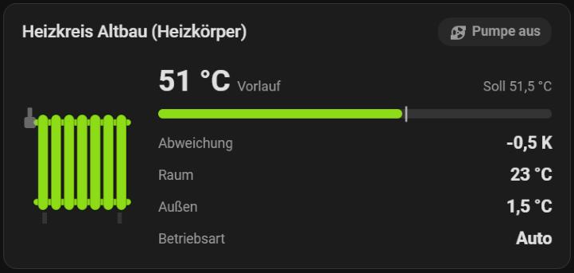

# Heizkreis-Karte

Heizkörper oder Fußbodenheizung, eingefärbt nach Vorlauftemperatur, mit Pumpe und Sollwert



## Installation

### Über den Marketplace (Home Assistant 2026.11 und neuer)

1. **Einstellungen** → **Marketplace** → **Aus Link hinzufügen**.
2. Die Adresse dieses Repositorys eintragen, Kategorie **Dashboard**.
3. **Heizkreis-Karte** installieren. Die Ressource wird dabei automatisch eingetragen.

### Über HACS (ältere Versionen)

**HACS** → ⋮ → **Benutzerdefinierte Repositories** → Adresse dieses Repositorys, Typ **Dashboard** → installieren.

### Manuell

`heizkreis-karte.js` nach `/config/www/` kopieren und unter **Einstellungen** → **Dashboards** → ⋮ → **Ressourcen**
als JavaScript-Modul `/local/heizkreis-karte.js` eintragen.

## Verwendung

```yaml
type: custom:heizkreis-karte
```

## Konfiguration

```
Heizkreis-Karte: Heizkoerper (Radiator) oder Fussbodenheizung als Grafik,
eingefaerbt nach Vorlauftemperatur; laeuft die Pumpe, fliesst das Wasser und es steigt Waerme auf.

  type: custom:heizkreis-karte
  titel: Heizkreis Altbau
  typ: radiator              # radiator | fussboden
  vorlauf: sensor.heizkreis_vorlauf_isttemperatur
  vorlauf_soll: sensor.heizkreis_vorlauf_solltemperatur   # optional
  pumpe: binary_sensor.heizkreis_pumpe_an_aus             # optional
  raum / aussen: sensor.x    # optional
  betriebsart: select.x      # optional
  min / max: Farbskala in °C # optional (Radiator 20..70, Fussboden 20..45)
```

## Lizenz

MIT
